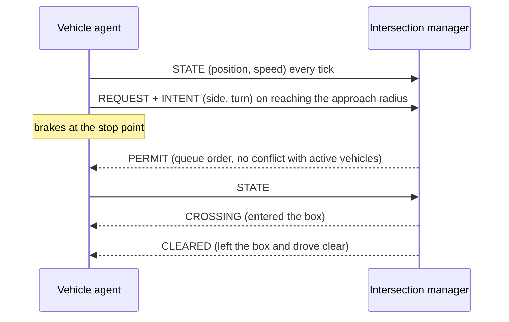

# Cooperative V2X Intersection for CARLA

A traffic-light-free junction. Vehicles talk to an **intersection manager** over a V2X-style message link, and the manager lets them through in arrival order, as long as their turns do not cross or merge. Built for the [CARLA](https://carla.org/) simulator (0.9.16) and described on the [project page](https://ruchirjadhav.dev/projects/carla-v2x-intersection).

The control logic is plain Python with no CARLA dependency, so it is tested and demonstrated offline; only the thin simulator glue needs a CARLA server.

## How it works



1. **Detect.** A vehicle that comes within the *approach radius* of the junction centre announces itself with a `REQUEST` and an `INTENT`: which side it arrived from and whether it will go straight, left or right.
2. **Queue.** The manager orders waiting vehicles by arrival time.
3. **Decide.** A vehicle gets a `PERMIT` only if its movement does not conflict with any vehicle that already holds one, and it may not overtake an earlier vehicle it conflicts with. Without a permit the vehicle brakes at its stop point.
4. **Cross.** Entering the *intersection box* sends `CROSSING`. Once the vehicle has left the box and driven clear (beyond 75% of the approach radius), the manager releases its permission and sends `CLEARED`.

### Which movements conflict

A movement is an approach side plus a turn. Each is drawn as a short path through the box, driving on the right, and two movements conflict when their paths cross or merge:

| Pair | Conflict? |
| --- | --- |
| Straight vs straight from the cross street | yes, they cross |
| Straight vs straight from the opposite side | no, they pass |
| Left turn vs oncoming straight | yes |
| Right turn vs cross-street straight | yes, they merge into the same lane |
| Right turn vs oncoming straight | no |

Turns are drawn with a sharp corner, which is deliberately conservative: opposing left turns are reported as conflicting even though a wide turn could slip between them. Vehicles from the same side never conflict, but they queue in order.

## Try it without CARLA

```bash
python -m coop_v2x.demo --vehicles 4
```

```
car  side  turn      arrived  allowed  entered  exited
  0     0  straight      0.8      0.8      1.9     5.7
  1     1  left          1.2      5.7      6.8    11.6
  2     2  straight      1.7     11.6     12.7    16.5
  3     3  right         2.1     16.5     17.6    20.4

vehicles:            4 complete, 0 incomplete
average wait:        7.20 s
average crossing:    3.80 s
time to clear all:   19.60 s
throughput:          12.2 vehicles/min
```

`--compare` runs every controller on the same scenario: the conflict-aware manager, plain first-come-first-served (one car at a time), and two fixed-cycle traffic signals speaking the same protocol. The default signal gives each approach its own 10 s green with 2 s of all-red, so like the manager it never lets conflicting movements meet; the two-phase signal is faster but is *not* conflict-free (its left turns cross oncoming traffic).

Time to clear everything, in seconds (average wait in brackets), at the default 20 m approach radius:

| Cars | Signal, one approach at a time | First-come-first-served | **Conflict-aware** |
| --- | --- | --- | --- |
| 4 | 39.1 (16.8) | 19.6 (7.2) | **19.6 (7.2)** |
| 8 | 41.1 (8.4) | 39.1 (12.9) | **30.3 (9.8)** |
| 16 | 43.1 (4.2) | 78.2 (15.5) | **56.9 (10.6)** |

How to read it: with light or moderate traffic the manager clears the junction faster than a fixed-cycle signal, because it never waits for a green that nobody needs. With all four approaches queued, a well-tuned signal catches up and wins, because it sends a whole platoon through on each green while the manager treats conflicts movement by movement. The manager never does worse than one-at-a-time control, and pulls ahead as traffic grows. The result also depends on geometry: a permission is held from the stop line until the car is clear, so a larger approach radius lengthens every permission (try `--approach 35`).

This is a kinematic model (constant-speed cars, no collisions, acceleration or reaction time) and a fixed scenario, so it shows how the controllers order traffic. It does not predict CARLA's numbers.

## Run in CARLA

You need a CARLA 0.9.16 server, the `carla` Python package that matches your CARLA release and Python version, and CARLA's `agents` package. `agents` lives in the CARLA install, so point `CARLA_ROOT` at it:

```powershell
$env:CARLA_ROOT = "C:\path\to\CARLA_0.9.16"
python -m coop_v2x.run_simulation --map Town05 `
  --spawn-indices "43,151,177,137" --dest-indices "151,43,137,177" `
  --center-x -45.5 --center-y 4.4 --center-z 0.45 `
  --approach 35 --box 12 --vehicles 4 --logfile metrics.csv
```

Run it from the repository root with `CarlaUE4` already started. On Linux or macOS use `export CARLA_ROOT=...` and drop the backticks. To compare against the baseline, repeat the run with `--controller signal`.

| Flag | Meaning |
| --- | --- |
| `--map` | Map to load, for example `Town05` |
| `--vehicles` | Number of vehicles to spawn |
| `--spawn-indices`, `--dest-indices` | Comma-separated spawn points and matching destinations, one per vehicle. Each vehicle's approach side and turn are worked out from these |
| `--center-x/-y/-z` | Junction centre. Without x and y it defaults to the average of the spawn points, so set it for any real junction |
| `--approach` | Approach radius in metres: where vehicles announce themselves and queue (default 35) |
| `--box` | Half-extent of the intersection box in metres (default 12). The approach radius must exceed it by at least 3 m |
| `--controller` | `cooperative` (default) or `signal`, the fixed-cycle baseline |
| `--policy` | Cooperative controller: `conflict-aware` (default) or `fcfs`, which ignores conflicts and lets `--max-active` cars through at once |
| `--max-active` | Cap on vehicles holding a permission at once (default: none, or 1 for `fcfs`) |
| `--green`, `--all-red`, `--signal-phases` | Signal timing, and whether each approach gets its own phase (`split`, the default, conflict-free) or two axis phases (`axis`) |
| `--permission-timeout` | Free the manager's slot for a permission that has not been used after this many simulated seconds (default: never). Set it well above the time a car needs to reach the box: the car keeps its permit |
| `--junction-yaw` | Rotate the four approach sides for a junction not aligned with the x/y axes |
| `--duration` | Stop after this many simulated seconds (default 120) |
| `--logfile` | Metrics CSV path (default `metrics.csv`) |
| `--list-spawns`, `--list-junctions` | Print spawn points or junction centres and exit |

Choose spawn and destination indices that route through your junction centre, otherwise vehicles never enter the managed box.

## Analyse a run

```bash
python -m coop_v2x.analyze_metrics metrics.csv
```

Per vehicle, *wait* is permission time minus arrival time, and *crossing* is the time from entering the box until the vehicle has cleared the junction area. Overall, *time to clear all* runs from the first arrival to the last exit, and *throughput* is vehicles per minute over that window. Vehicles that never completed a crossing are counted as incomplete rather than averaged in.

## Layout

| File | Role |
| --- | --- |
| `coop_v2x/junction.py` | Approach sides, turn intents, movement paths and which movements conflict |
| `coop_v2x/messaging.py` | The six message types and the in-memory mailbox standing in for the radio link |
| `coop_v2x/vehicle_client.py` | A vehicle's side of the protocol (announce, report, hold or go) |
| `coop_v2x/intersection_manager.py` | The conflict-aware manager, plus the fixed-cycle signal baseline |
| `coop_v2x/vehicle_agent.py` | CARLA's `BasicAgent` wired to the client |
| `coop_v2x/run_simulation.py` | CARLA entry point: map, synchronous stepping, spawning, main loop |
| `coop_v2x/offline_sim.py`, `demo.py` | The offline simulation and its command line |
| `coop_v2x/logging_utils.py`, `analyze_metrics.py` | Metrics CSV writer and summary |

## Tests

```bash
pip install -r requirements-dev.txt
pytest
```

85 tests, none needing CARLA. They cover the conflict geometry (including symmetry and rotation invariance), the protocol, every manager rule, the signal timing, and whole-scenario safety checks: no two conflicting movements ever share the box, every car finishes across a range of approach radii and speeds, and the CARLA agent behaves correctly against stand-ins for the simulator.

## Scope and limitations

- `run_simulation.py` and `vehicle_agent.py` need a live CARLA server. The tests exercise them against stand-ins; they have not been run in CI.
- A vehicle's turn is read from the angle between its spawn and destination, which approximates the route CARLA's planner takes.
- The intersection box is axis-aligned, so on a junction rotated against the world axes it is only an approximation; `--junction-yaw` aligns the sides but not the box.
- Communication is instant and lossless. A real V2X link would add delay, loss and range limits.
- One junction, fully cooperative vehicles, no pedestrians or human drivers.
